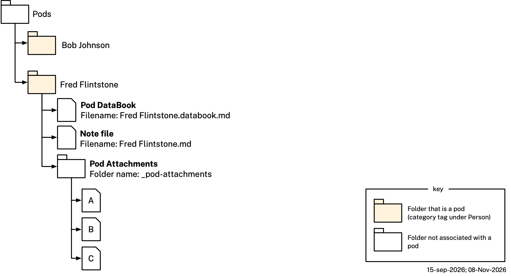

# App Behavior

This file continues [README.md](README.md) and [example.md](example.md), which describe the Category, Pod, Graph, Persona, Organization, and Service ontologies and illustrate them with a worked example. This file documents how the app behaves *on top of* that data — pod lifecycle, storage, sharing, permissions, naming/renaming, what actions a user can take on a pod, what happens when a shared pod arrives somewhere new, and so on.

Nothing in this file changes any `.ttl` file or DataBook triple — every rule here is app-level behavior, not an ontology rule. This file is also written at the **user level** throughout: it describes what a member can do and sees in the app, not how the PDN layer beneath implements it. The two can legitimately differ, and where they do this file follows the user's view — see [Tool & Member Info Permissions](#tool--member-info-permissions) for the case where they diverge most visibly.

## Pod Storage

Pods are stored on the user's device(s) or, for an organization's own `s:ServiceProvider`, on Personal Data Network (PDN) nodes hosted by that organization. **A pod is never persisted in the user's filesystem**: its entire content lives in a protected, app-managed store, encrypted at rest — see [storage.md](storage.md) for where pod content lives and why. Apart from one exception a member opts into, no pod is ever stored by any cloud provider, or any third party of any kind, including The Mee Foundation: a member who invites a backup service into a pod as a member (see [Inviting Backup Services](#inviting-backup-services) below) has that service's provider keep a copy of the pod, and only of that pod. When a pod is shared, changes to its contents — including its own name, except in a bare two-member pod (see [Naming, Renaming, and Sharing](#naming-renaming-and-sharing) below) — propagate to every member over the PDN; see [Pod Contents](#pod-contents) and [Naming, Renaming, and Sharing](#naming-renaming-and-sharing) below for what stays independent per member instead. Three things a member holds in a pod never propagate at all: their own **private files**, as against the **attachments** every member receives (see [Pod Contents](#pod-contents) below); their own **tags** — `pod:categoryTag` and `pod:userTag` values they chose, and `pod:serviceTag` values their own module wrote (see [Tags](README.md#tags) in README.md), though a sender's category tags accompany an invitation as suggestions (see [Joining a Pod](#joining-a-pod) below); and a user's direct messages with their own personal agent, @Telli, in the pod's chat area (see [Chat Area](#chat-area) below). The first is the member's own choice about a file of theirs, the second their own way of classifying and finding the pod, and the third a private conversation with their own agent. A direct message between two members propagates only to those two.

### Pod Contents

A pod is a unit the app manages, identified by its own stable id (see [Deriving and Checking a Pod Id](#deriving-and-checking-a-pod-id) below). Nothing marks it in a filesystem, because it is not in one. A user's pods are a flat set. What gathers pods together is their **tags** — see [Finding Pods by Tag](#finding-pods-by-tag) and [Persistent Views](#persistent-views) below. A member's tags on a pod are per-member state in that member's own store, never shared content, which is what lets two members of a shared pod each classify it however they like without touching what the other sees.

A pod carries zero or more `pod:categoryTag` values per member, even from unrelated branches of the taxonomy. Each is a category concept — a `skos:Concept`, always ultimately reachable from `podcat:Person` or `podcat:Organization` — that the member has tagged the pod with. That concept is normally one of `podcat:PodCategoryScheme`'s own, reached by following `skos:broader` upward, but it may instead belong to a [category extension](README.md#category-extensions)'s own scheme, in which case the path runs through that concept's single `skos:broadMatch` into the core taxonomy first and then upward by `skos:broader` as usual (`bhscat:BostonHubSociety` → `podcat:Groups` → `podcat:Person`). The member adds and removes category tags freely. A pod's **category type** is derived from the top concepts its category tags reach: **Person** when every tag reaches `podcat:Person`, **Organization** when every tag reaches `podcat:Organization`, **Mixed** when its tags reach both, and **Custom** when the pod carries no category tag at all. Custom is identified precisely, not by judgment call: the pod simply carries no `pod:categoryTag` value.

A pod's own **name** is a separate, purely display-level choice, independent of the above: the name may be copied verbatim from one of its category tags' own `skos:prefLabel` (e.g. a pod named "Things" tagged `podcat:Things`), or the user may give it a different name entirely (e.g. a pod named "Bob Johnson" tagged `podcat:Others`). The user may also give it no name at all, and the app then assigns `Untitled-N`, the lowest number free among their own pods (see [Naming, Renaming, and Sharing](#naming-renaming-and-sharing) below). Names need not be unique: everything that refers to a pod — a note's link, a search result, a persistent view — resolves it by its stable id, never by its name. The app's own record of the name is authoritative, and there is no independent display-name override anywhere. Except in a bare two-member pod, this name is part of the pod's own shared content: it is kept in sync and identical across every member's copy, exactly like its graphs, its attachments, its note (a note's own text, including any links it contains, but not necessarily the resolvability of a link pointing outside the pod — see the note description below), its group chat stream (direct messages reach only their participants — see [Chat Area](#chat-area) below), and everything else the pod carries (see [Introduction to Pods](README.md#introduction-to-pods) in README.md). What stays independent per member is their own **tags** — category, user and service tags alike. A bare two-member pod — one between two people, carrying no form about anyone or anything but themselves — is the one exception: there, the name itself is also independent per member, alongside the tags, rather than shared — see [Naming, Renaming, and Sharing](#naming-renaming-and-sharing) below.

- A pod's **attachments** are the files every member of the pod receives, shown in the app's **Attachments area**, and they are what travels with the pod when it's shared. Each is a `pod:attachment` value, described as a `sources:SourceItem` (see [Pod Properties](README.md#pod-properties) in README.md). Attachments are flat, like email attachments. A file the member adds to the pod without attaching it is instead their own **private** file — it stays in their copy of the pod, syncs across their own devices like the rest of it, and never reaches another member. Both sets are shown in this same area: the attachments plainly, and the private files badged (🔒) under their own divider, keeping whatever structure the member has given them rather than being flattened in alongside the attachments. A file is attached or made private by dragging it across, and a member may hold private files in a pod that has no attachments at all. The distinction is about propagation and nothing else, so it is real even in the ordinary case of a single-member pod that shares nothing: it records what *would* travel if the pod were ever shared later — which is exactly the moment a wrong default would bite. Private content may be organized however the member likes; the flatness above is about what travels, and nothing that stays put needs it.
- A pod's **note** is shown in the app's Note area. A pod has exactly one, never more: a rich-text document with Markdown-like formatting, which every member may edit, at the same time if they like (see [Note Area](#note-area) below). The note is not stored as Markdown. It is kept in the app's own internal format, tuned to the two things Markdown handles badly — links that must resolve by id rather than by text, and concurrent edits from several members that must merge rather than overwrite one another — and any member can export it as a Markdown file. Besides formatting, a note carries two kinds of link:
  - **Pod links** work the way links do in PKM (Personal Knowledge Management) tools: a note may link to any other pod the user holds, not just to content within its own pod. Once a link's target has actually been instantiated as a pod (see [Wikilink-Triggered Pod Creation](#wikilink-triggered-pod-creation) below for the one case where it hasn't been yet), the link resolves by that target pod's own stable, globally unique id (see [Pod Id](pod-databook.md#id)) — not by matching its display text. The user types one with the wikilink syntax those same tools use, `[[foo]]`, and the Markdown export writes a resolved one in their alias syntax — `[[7f3a9c2e5d41b08f…|foo]]`, id before the pipe, display text after — and an unresolved one with no target yet (see below) as plain `[[foo]]`, no pipe at all. Inside the app neither string is what is stored: the link is an element of the note that carries its display text and, once resolved, the target's id. A link's own display text travels with the pod's note when the pod is shared, but resolution never falls back to text-matching. This matters because pod names are not unique (see [Naming, Renaming, and Sharing](#naming-renaming-and-sharing) below) — a recipient can easily hold an unrelated pod that happens to share a display name with the intended target, and id-based resolution is what keeps a link from ever silently jumping to that wrong pod instead. What id-based resolution can't fix is the linked-to pod itself not traveling with the note: if the target lies outside this pod's own boundary (i.e. it isn't part of this pod's own Attachments-area content or its own note) and the recipient doesn't independently have a pod carrying that id — because it was never shared with them — the link simply won't resolve on their side; it fails closed (inert, shown as unresolved) rather than open (silently pointing somewhere else). This is an accepted limitation of cross-pod linking, not a defect. That boundary has an inner edge as well: a link whose target is one of the member's own private files resolves in their own copy and fails closed on every other member's side, since a private file never travels — the same inert-rather-than-wrong behavior, for the same reason.
  - **Block links** point at structured content inside the note's own pod: one of its tools (a form, a calendar, a map), one of its graphs (a `pod:MemberGraph` or a `pod:FormGraph`), or one of its attachments. Clicking one opens that content in its own area of the pod. Because the target sits inside the same pod as the note, it travels with the note when the pod is shared, so a block link resolves for every member, not only for its author. The one exception is the inner edge above: a block link to one of the member's own private files fails closed on every other member's side, since that file never travels. A block link whose target is later removed — a tool deleted, a graph withdrawn, an attachment deleted — is shown as unresolved and is never retargeted to some other block. The Markdown export has no equivalent for a block link and writes its display text instead. Every block-link target is resolved by its own IRI — a tool's id, a graph's id, an attachment's `sources:SourceItem` IRI — never by its name or its position, so renaming a tool or reordering the pod's tools never retargets a link (see [Tool Ids](pod-databook.md#tool-ids) in pod-databook.md).

### Scaffolding: This Repo's Filesystem Tree

The app does not exist yet, so this repository carries its worked example on disk, as a flat set of folders under `example/Pods/`: one folder per pod, `example/Pods/<Name>/`, none of them nested inside another, each marked as a pod by a reserved `_pod-attachments` folder directly inside it, holding that pod's structured content as a `.databook.md` file, its note, when it has any content, as a Markdown file named after the folder (a stand-in approximating what the app's Markdown export of the note would write, not the note's own format; an empty note has no file), its attachments inside the reserved folder, and the member's own private files loose beside them. **All of that is development scaffolding** — a way to carry, validate and diagram real pod content before there is an app to hold it — and none of it is a commitment about how Tellipod stores anything. It is specified in [Development Scaffolding](pod-databook.md#development-scaffolding) in pod-databook.md, which is the file to read wherever this repo's layout and the model above appear to disagree; [storage.md](storage.md) draws the boundary between the two.

The diagram above shows that layout. `Pods` (`example/Pods/`) is not itself a pod, so its folder is drawn white. Directly inside it sit two pods, side by side and neither nested in the other. The expanded one, Fred Flintstone, holds:

- its pod DataBook, `Fred Flintstone.databook.md`;
- its note file, `Fred Flintstone.md`;
- its `_pod-attachments` folder, holding three example attachments, A, B and C, which every member of the pod receives.

A folder that is a pod is drawn with its pod's fill, set by its category type (see [Pod Contents](#pod-contents) above): tan for Person, light blue for Organization, a light-blue-to-tan gradient for Mixed, purple for a pod with no category tag. Both pods here are tagged under Person, so both are tan. Every other folder, `_pod-attachments` included, stays white. A pod folder's name is the pod's name, carried in the DataBook's `title:` field, which mirrors the folder and the `<Name>.databook.md` filename verbatim (integrity.md's YAML-5; see the [Filename Convention](pod-databook.md#filename-convention) in pod-databook.md). The diagram does not show the member's own private files, which sit loose in the pod folder beside the DataBook and never reach any other member.

A pod's own folder may not hold a private file or subfolder named `_pod-attachments`, that being the reserved folder that holds its attachments.

### Deriving and Checking a Pod Id

The creating device derives a new pod's id (see [Pod Id](pod-databook.md#id)) at the moment of creation and writes the pod's founding event. Every member device checks the founding event when it arrives, a newly linked device's first sync included: it recomputes the id, verifies the signature, and drops the event on any mismatch.

## Pod Management

This section is about how the app manages a **pod** specifically — its lifecycle, membership, permissions, naming, and what happens when one is shared.

### Lazy Instantiation

A pod is not created until the user wants one, and a template is applied to it whenever the member adds a category tag naming a concept that is templated — one for which some `pod:TemplatePod` carries a matching `pod:category` value, found by the reverse lookup `?tc pod:category X`. That happens equally when the pod is created with the tag and when the tag is added to an existing pod, and it happens once per tag: a pod given several templated tags gains what each of their templates declares. The pod gains one live `pod:tool` for each tool the template declares via `pod:declaresTool` that it does not already carry (19 of the 107 templates declare one, e.g. `podcat:MedicalAppointment`'s, `podcat:IdVerification`'s, `podcat:PetsMedical`'s, `podcat:Companies`'s, and `podcat:Home`'s; a few of them, e.g. `podcat:HealthWellness`'s, declare a form whose fields are all optional rather than one for a specific document type). Each live tool is minted a fresh id of its own as it is created — the declaration it was cloned from has none (see [Tool Ids](pod-databook.md#tool-ids) in pod-databook.md). The pod itself is always typed `pod:InstancePod`, never the template.

A tool already present is not added twice. Tools are shared content, so a tool gained this way reaches every member of the pod, even though the category tag that prompted it stays in the tagging member's own copy. **Removing a category tag never removes a tool**: a tool the removed tag's template supplied, and whatever claims its graphs hold, stay exactly as they are, and a newly added tag only adds whatever its template declares that the pod lacks.

If the user instead creates a pod with **no category tag** at all (the Custom case), there is no concept to drive the usual reverse lookup, so this one case falls back to a fixed template instead: `ctpl:UserDefinedTemplatePod` (`pod-category-templates.ttl`) — the one `pod:TemplatePod` carrying no `pod:category` value, found as that unique category-less template rather than by matching a category. It carries only `pod:memberShape pshapes:ContactInfoShape` and declares no tool, so it supplies only the pod's member baseline — a contact-info view of its member(s).

A pod stores no shape of its own, and its category tags are no reliable guide to one: tags are per-member, can be added or removed over time, and members may tag the same pod differently. Instead, when a member fills in a `pod:member` graph or a tool's own graph, the app stamps that graph's own `pod:shape` value from the template or templates that supplied it — every `pod:memberShape` of the templates the pod's category tags reach, for a `pod:member` graph, or the `pod:formShape` of the declared tool for a tool's own graph — copying the shape's CURIE directly, since `pod:shape`'s range is `sh:NodeShape` (`pod.ttl`), the same range `pod:memberShape` and `pod:formShape` already carry. From then on each graph's own `pod:shape` is the validation authority for that graph. For example, a `podcat:Passport`-tagged pod's sole tool graph was supplied by `ctpl:PassportTemplatePod`, whose declared tool carries `pod:formShape idocshapes:PassportShape`, so the graph's own `pod:shape` is stamped `idocshapes:PassportShape` — integrity.md's TTL-3 separately verifies that shape's own `sh:targetClass` (`idoc:Passport`) is asserted via `rdf:type` on the graph's own new document individual; TTL-4 verifies the graph's `shape:` value itself against the templates of the pod's category tags.

Every one of the 107 templates in `pod-category-templates.ttl` uses `pshapes:ContactInfoShape` as its own `pod:memberShape` (a `pod:member` graph is always validated as a basic contact-info profile, regardless of category, while any category-specific content lives in a tool instead), so every real `pod:member` graph of a pod tagged with core categories is likewise stamped `pshapes:ContactInfoShape` uniformly (a [category extension](README.md#category-extensions)'s template may name a member shape of its own, as the Boston Hub Society's `bhsshapes:MemberShape` does) — even though that shape's own `sh:targetClass` is the broad `persona:Person` rather than a narrow reified document class, since it validates the graph's own subject individual in place rather than a separate reified document (integrity.md's TTL-3 exempts this shape from the rdf:type-matching rule, together with a category extension's member shape such as `bhsshapes:MemberShape` for the same reason, since a `pod:member` stub graph legitimately need carry no `persona:Person` individual at all — e.g. an organization's own self-claimed member stub). Every `pod-categories.ttl` concept, the two SKOS top concepts `podcat:Person`/`podcat:Organization` included, has a matching `pod:TemplatePod` (integrity.md's TTL-6), and `ctpl:UserDefinedTemplatePod` covers a pod with no category tag, so every real `pod:member` graph has a template to take its `pod:shape` from.

### Number of Members

A pod can have just one member (the user) or several. We don't yet know how many members a pod can support, but the number is almost surely well under 100. An invited agent service (`s:AgentService`, such as a [backup service](#inviting-backup-services)) is a real member too, and counts toward this same tally — inviting one raises a single-member pod to a two-member pod, exactly as inviting a human would.

### Permissions

Pod-level capabilities are governed by two independent axes: **ownership** (`pod:owner`, pod.ttl — owner vs. regular member) and **identity type** (human or service). A pod's creator (`pod:creator`) is always its initial, and until any promotion its sole, owner; any current owner may promote any other current regular member of `p:Person` identity — never an `s:Service`, which can never hold the owner role, mirroring `pod:creator`'s own person-only range — to owner, at which point that member's capabilities change as shown below. Any current owner may likewise demote another owner back to regular-member status, so ownership is not permanent once granted — the one limit being that a pod always retains at least one owner (`pod:owner` carries `sh:minCount 1`), so the last remaining owner cannot be demoted. A single-member pod has only its creator, who is trivially its sole owner — the owner/regular-member distinction only becomes observable once a pod gains a second member. There is no separate guest tier — every member, of any identity type, has exactly the same access as any other member of the same ownership status.

Capabilities are grouped by the surface they govern, one table each: the **pod container** itself, its **attachments**, its **note**, and its **tool & member info** (graph claims). A capability appears in exactly one table.

Each table has three permission columns. A pod's members are only ever people or services; the first two columns split the people by ownership:

- **Owner** — a person currently holding the owner role. The pod creator immediately becomes the pod's first, and initially sole, owner.
- **Member** — a person who is not currently an owner.
- **Service** — a service, always a non-owner.

Every cell in every table carries a decided value, except where an Open Issue is noted. A cell reading `n/a` marks a capability that genuinely cannot apply to that role, rather than one left open — an `s:Service` can invite no one, so it can never have a self-invited member to remove.

#### Pod Container Permissions

| Capability | Owner | Member | Service | Open Issue |
|---|---|---|---|---|
| Create pod | yes | yes | no |  |
| Invite member to a pod | yes | yes | no |  |
| Uninvite self-invited member | yes | yes | n/a |  |
| Remove member from pod | yes | no | no |  |
| Remove owner-member from pod | yes | no | no |  |
| Leave pod | yes | yes | yes | #2 |
| Rename pod for all members | yes | yes / no  | no |  #1 |
| Delete pod locally | yes | yes | yes | #2 |
| Delete pod for all members | yes | no | no |  |
| Promote member to owner | yes | no | no |  |
| Demote owner to member | yes | no | no |  |
| Out-of-pod communications | yes | yes | no |  |

**Open Issues**

1. **Rename** — may any member rename a pod for everyone, or only an owner? This document's [Naming, Renaming, and Sharing](#naming-renaming-and-sharing) section argues at length for any member, against the Microsoft Teams/Discord/GitHub precedent; Vladimir and Sergey restrict it to owners.
2. **Leave vs. delete locally** — does *Leave pod* subsume *Delete pod locally*, or are they distinct? Leaving withdraws one's membership, which propagates; deleting locally removes the pod from one's own set of pods only. They are kept as separate rows pending an answer.

**Capabilities**

- **Create pod** — create a new pod among one's own pods, named or not (an unnamed pod is given `Untitled-N` — see [Naming, Renaming, and Sharing](#naming-renaming-and-sharing) below). Only a human can: `pod:creator`'s range is `p:Person` alone, so no service — provider, website, or backup — can originate a pod, and none can invite anyone into one either. An organization's relationship with a person therefore only ever exists because the person created the pod and invited that organization's `s:ServiceProvider` into it; the organization cannot open the conversation.
- **Invite member to a pod** — invite a person, or a service (a backup service or an organization's own service), to a pod of which one is already a member.
- **Uninvite self-invited member** — remove a pod member whom this member originally invited.
- **Remove member from pod** — remove any regular (non-owner) member.
- **Remove owner-member from pod** — remove a member who currently holds the owner role, as distinct from removing a regular member.
- **Leave pod** — withdraw one's own membership, dropping oneself from `pod:member` (and from `pod:owner`, if held). Its relationship to *Delete pod locally* is unsettled.
- **Rename pod for all members** — change the pod's shared name so the change propagates to every member's copy. See [Naming, Renaming, and Sharing](#naming-renaming-and-sharing) below for the full rule, including the bare two-member-pod exception where the name is independent per member rather than shared.
- **Delete pod locally** — remove the pod from this member's own pods only, not from any other member's copy.
- **Delete pod for all members** — remove the pod from every member's copy. Only an owner can do this.
- **Promote member to owner** — add a current regular member (a `p:Person`, never an `s:Service`) to `pod:owner`.
- **Demote owner to member** — remove a current owner from `pod:owner`, returning them to regular-member status. Restricted to owners, and never applicable to the pod's last remaining owner, since `pod:owner` requires at least one value.
- **Out-of-pod communications** — communicate with another pod member outside the pod, by email or SMS, using contact information about that member that they have put in the pod.

#### Attachment Permissions

An attachment is a file every member of the pod receives, shown in the app's Attachments area (see [Pod Contents](#pod-contents) above). An attachment is **immutable**: once added, its content is never updated in place by any role, so a correction means deleting it and adding the corrected file. Vladimir and Sergey call this an *immutable document*, a PDF being their example.

A file the member adds to the pod without attaching it is instead their own **private** file, which no other member ever receives. Every row below reads the same for one, with a single difference: both *another member's* rows become `n/a`, since no other member ever has one of this member's private files to read or delete. An agent service reaches exactly what its principal reaches — its access is its principal's access (see [Pod Interface](#pod-interface) below) — so a member's own agent service, such as a backup service, sees their private files. No other service ever does: neither an agent service acting for another member, nor a service provider or website service, which acts for no member at all.

| Capability | Owner | Member | Service | 
|---|---|---|---|
| Read own attachment | yes | yes | yes | 
| Read another member's attachment | yes | yes | yes | 
| Add own attachment | yes | yes | yes | 
| Add an attachment as if authored by another member | no | no | no | 
| Update own attachment | no | no | no | 
| Update another member's attachment | no | no | no | 
| Delete own attachment | yes | yes | yes | 
| Delete another member's attachment | yes | no | no | 

- **Read own attachment** / **Read another member's attachment** — retrieve an attachment's content, one's own or one added by a different member.
- **Add own attachment** — put a new file into the pod's flat attachment set, authored as oneself.
- **Add an attachment as if authored by another member** — attribute a newly-added attachment to a member other than oneself. No role may do this.
- **Update own attachment** / **Update another member's attachment** — modify an existing attachment's content in place. No role may do either: an attachment is immutable, so replacing one means deleting it and adding the corrected file, which re-dates it and re-attributes it to whoever added the replacement.
- **Delete own attachment** — remove an attachment one added oneself.
- **Delete another member's attachment** — remove an attachment a different member added.

Two further capabilities move a file across the boundary between the two sets. Attaching one's own private file is just *Add own attachment* above; the reverse direction is its own capability:

| Capability | Owner | Member | Service | 
|---|---|---|---|
| Make own attachment private | yes | yes | yes | 
| Make another member's attachment private | no | no | no | 

- **Make own attachment private** — move an attachment one added oneself back among one's own private files. Every other member sees this as a deletion, which every role may already do to an attachment of their own.
- **Make another member's attachment private** — do the same to an attachment a different member added. No role may, owner included. The objection isn't the deletion — an owner may delete another member's attachment outright — but keeping a copy of a file every other member has been told is gone.

#### Note Permissions

A pod has **exactly one note** (see [Pod Contents](#pod-contents) above and [Note Area](#note-area) below) — never more. Vladimir and Sergey call this a *mergeable document*, and their own row labels distinguish a member's "own" document from "another member's"; with one note per pod that split does not arise, so the rows below are stated as capabilities on the pod's single note. Every member may write to it, regardless of ownership — reading and writing the note is the one surface where the owner/regular-member distinction does not apply at all. There is no commenting or suggested-edit mechanism of any kind — no margin comments, no proposed inline changes, and so no accept-or-reject step; a member simply edits the note, and every other member sees the result.

| Capability | Owner | Member | Service | 
|---|---|---|---|
| Read the note | yes | yes | yes | 
| Edit the note | yes | yes | yes | 
| Clear the note | yes | yes | yes | 
| Export the note as Markdown | yes | yes | yes | 

- **Read the note** — retrieve the note's current content.
- **Edit the note** — change the note's content, with no review step. Members may edit at the same time: their concurrent changes merge into the one note rather than one overwriting another, which is what the note's internal format is for (see [Pod Contents](#pod-contents) above). Since a pod has one note that every member may write, there is no distinction between editing one's own text and editing another member's; Vladimir and Sergey's own two edit rows collapse into this one for the same reason.
- **Clear the note** — remove the note's content, leaving it empty. Available to every member, since a member who may edit the note may in any case blank it.
- **Export the note as Markdown** — save a Markdown rendering of the note outside the app. Available to every member, since a member who may read the note may in any case copy it. The export is lossy where Markdown has no equivalent: a block link becomes its display text.

#### Tool & Member Info Permissions

These govern the graph claims backing a pod's `pod:member` and tool content — what Vladimir and Sergey call a *claim*. Every row is scoped by claimant: a member's own claims are the ones they themselves claim. **A claim is editable, as the user experiences it.** A member who wants to correct their email address in a `pod:member` graph just edits the field, and the app presents that as an ordinary update — which is why the `Update own claim` row below reads `yes`.

Underneath, at the **PDN layer**, there is no update operation on a claim at all: a claim is immutable, and the app implements the edit by deleting the claim carrying the old email address and issuing a fresh claim carrying the new one. Nothing about that reaches the user — they see a field they changed, not a retraction and a re-issue. The graph itself is never replaced either way; it stays one evolving graph whose claims come and go beneath it.

This document describes the first of those two layers, so every row below is the user-level rule. Vladimir and Sergey's own tables describe the second, which is why their `Update own claim` row reads `no` where this one reads `yes` — the two are not in conflict, they are the same behavior seen from either side of that boundary.

| Capability | Owner | Member | Service | 
|---|---|---|---|
| Read own claim | yes | yes | yes |  
| Read another member's claim | yes | yes | yes |  
| Issue own claim | yes | yes | yes |  
| Issue a claim as if issued by another member | no | no | no | 
| Update own claim ¹| yes | yes | yes |  
| Update another member's claim | no | no | no | 
| Delete own claim | yes | yes | yes | 
| Delete another member's claim | yes | no | no | 

¹ User-level, this is an ordinary edit of one's own claim. At the PDN layer the claim is immutable and the edit is carried out as a delete plus a fresh claim — which is what Vladimir and Sergey's `no` records. Same behavior, different layer.

- **Read own claim** / **Read another member's claim** — read a graph claim, one's own or one another member claims. Read access is unrestricted across the pod.
- **Issue own claim** — assert a new claim as claimant, in a `pod:member` graph or a tool's own graph one claims oneself.
- **Issue a claim as if issued by another member** — attribute a newly-issued claim to a claimant other than oneself. No role may do this.
- **Update own claim** — change the value a claim one issued oneself carries, e.g. correcting one's own email address. An ordinary edit as far as the user is concerned; a delete-and-re-issue underneath (see above).
- **Update another member's claim** — change a claim a different member issued. No role may do this at either layer: write access is always scoped to one's own claimant identity.
- **Delete own claim** — retract a claim one issued oneself.
- **Delete another member's claim** — retract a claim a different member issued.

### Naming, Renaming, and Sharing

Except in a bare two-member pod, the pod's name is shared, and the rule this document proposes is that any person who is a member of the pod — not just its creator or another owner — can rename it, the new name propagating to every member (this is Open Issue #1 under [Permissions](#permissions) above, and a service can never rename a pod): renaming is not gated by ownership, unlike other-member claim/attachment deletion (see [Permissions](#permissions) above). Likewise every member may post in the pod's chat regardless of ownership status, and any member may add or delete their own attachments — though no member may update an attachment in place, since an attachment is immutable, and what a member keeps among their own private files rather than attaching is their own affair, gated by nothing. This mirrors how **Slack** and **Notion** handle renaming by default: any member/editor can rename a channel or page, and the new name propagates to everyone. It's a deliberate contrast with **Microsoft Teams** (channel owners only, by default), **Discord**, and **GitHub**, which restrict renaming to a privileged admin/Manage-Channels/owner role — a distinction the app's pod model doesn't have to begin with. A bare two-member pod does *not* follow this rule — see the exception below.

A pod's name need not be unique. Two of a member's pods may share a name, whether the member gave it to both, a shared pod arrived carrying a name one of their own pods already has, or a later rename produced the match; the app neither suffixes nor rejects either one. Nothing depends on a name being unique, since every reference to a pod — a note's link, a search result, a persistent view — resolves by the pod's stable id (see [Pod Contents](#pod-contents) above).

**Unnamed pods.** A member creating a pod need not name it. When they leave the name empty, the app assigns one at creation: `Untitled-N`, where N is the smallest positive integer for which none of the member's own pods is currently named exactly `Untitled-N`. Only names of exactly that form count — `Untitled-` followed by digits — and a member who typed `Untitled-2` themselves has taken that number just the same. Numbers freed by deleting or renaming a pod are reused. Renaming a pod to an empty name assigns the next free `Untitled-N` the same way, so a pod is never nameless. Once assigned, the name is an ordinary name: nothing records that the app chose it, any member may rename it under the rules above, and it propagates exactly as any other name does — shared content in general, per-member in a bare two-member pod. The numbering does not contradict the rule that the app neither suffixes nor rejects a name: a name a member chooses is never altered, and numbering applies only when there is no name to start from. Nor is it a uniqueness guarantee — it avoids a clash among the member's own pods at the moment of assignment, and a pod shared with them, or a later rename, may still produce two pods named `Untitled-3`, which is harmless for the same reason any duplicate name is. A pod the app names from something else — a wikilink's text (see [Wikilink-Triggered Pod Creation](#wikilink-triggered-pod-creation) below), a chunk [Tidy](#tidy) moved out, a site in the presenting flow — takes that name instead; `Untitled-N` is the fallback only when no name is supplied or derivable.

**Exception: bare two-member pods.** A two-member pod is *bare* when it carries no form whose `pod:formTopic` is anyone or anything other than its two members: it may carry no tool at all, only tools with no topic (such as a `pod:Browser`), or only forms about one of the two members themselves. The exception holds only between two people: a two-member pod whose second member is a service — a backup service, an organization's service provider, or a website service — follows the general shared-name rule, since a service has no perspective of its own on the relationship to name the pod from. A bare two-member pod's name is never shared, synced content between its two members, in contradiction to the general rule above — each member is independently responsible for the name on their own side. This is because a bare two-member pod is an asymmetric dyad about the relationship *between* its own two members: each member's name for it naturally reflects their own perspective on the *other* party, and there's no single name that fits both (e.g. Alice's pod with Bob, below). A two-member pod carrying a form about a third party, by contrast, is about that third party, on which neither member's own perspective differs — its derived subject (see README.md's [Pod Ontology](README.md#pod-ontology) section) is the form's topic regardless of which member is looking, so there's no asymmetry to preserve, and it follows the general shared-name rule above instead, exactly like a pod with three or more members (a genuine group identity with no single "other side" to name from either). For example, the `Medical Appointment` pod Alice shares with her husband Dave — a two-member pod whose one form tool is about their daughter Sophia — has one shared name kept in sync on both sides, renamable by either Alice or Dave. Their `Sophia Walker` pod (see example.md's [Taking Care of Sophia](example.md#taking-care-of-sophia)) has the same shape and follows the same rule.

For a bare two-member pod, the creator's name for their own copy is simply whatever they set it to — chosen and renamed exactly as for any other pod, but never propagated to the recipient's copy.

At **first-time receipt** of a bare two-member pod — the recipient self-evidently did not create it, they're joining one already created — the app does not just adopt the creator's name as shared content. Instead, once, at that first receipt, it analyzes the `pod:member` graph(s) belonging to the pod's creator/sender member and auto-generates a name for the pod from that analysis. (The sender's own choice of name for their copy is naturally centered on their own perspective, so blindly reusing it verbatim on the recipient's side would be a poor fit; analyzing the sender's own member graphs lets the recipient's app derive a name that makes sense from its own side instead.) If that analysis yields no usable name — the sender's member graphs carry no given name, say — the recipient's app falls back to the next free `Untitled-N` among the recipient's own pods (see Unnamed pods above).

For example, Alice creates a bare two-member pod about her relationship with Bob and names it "Bob Johnson" on her own side, then shares it with Bob. On first receipt, Bob's app doesn't just copy "Bob Johnson" — that's Alice's name for *him*, not a name that makes sense among Bob's own pods. Instead it scans the pod's `pod:member` graph(s) belonging to Alice, finds a graph about Alice herself, extracts her given name, and names the pod "Alice" on Bob's side instead.

From that point on, both the creator's and the recipient's names for their own copies may be freely renamed at any time, exactly like a single-member pod's name — but such a rename stays purely local to the renaming member's own copy and is never propagated to the other member's copy, in either direction. This is what keeps the first-receipt divergence meaningful: if a later rename on either side rippled to the other, it would silently overwrite a name chosen to fit that member's own perspective, defeating the reason the divergence exists in the first place.

### Wikilink-Triggered Pod Creation

A pod's note may contain a wikilink with no target id at all yet — one whose linked-to name has never been instantiated as a pod by anyone (see [Pod Contents](#pod-contents) above for how an already-instantiated link instead resolves by stable id, not display text). Since a note is never a standalone unit in this app — it's always the single note *of* a pod, never anything on its own — clicking such a truly-new link can't create an orphan note the way a flat-file PKM tool would; the only creatable target that actually fits the model is a new pod.

Clicking a no-id wikilink therefore creates a new pod named after the link text (e.g. `[[foo]]` creates a pod named "foo") — the same "click an unresolved link to create its target" behavior familiar from PKM tools, but creating a pod rather than a bare note. The new pod has no category tag; the user may tag it afterward, exactly like any other pod. If the user already holds a pod named "foo", the new one simply shares that name (see [Naming, Renaming, and Sharing](#naming-renaming-and-sharing) above). Creating the pod also derives its stable, globally-unique id — from the creator's PDN ID, a public key of the creator's identity and fresh random bytes (see [Pod Id](pod-databook.md#id)), not the small sequential `pod-<NN>` this repo's own example data uses — and attaches that id to the clicked link, whose display text "foo" is unchanged (the Markdown export now writes it `[[7f3a9c2e5d41b08f…|foo]]` rather than `[[foo]]`), so every later click by anyone who has access to that same pod resolves deterministically to it — never by re-matching on the display text "foo."

The new pod carries no `pod:categoryTag` at all, so this is the same **Custom** case described in [Pod Contents](#pod-contents) above, and its member baseline comes from `ctpl:UserDefinedTemplatePod` (see [Lazy Instantiation](#lazy-instantiation) above). It is a single-member pod, created by and with `:Self` as its sole member, following the same minimal-stub-graph pattern used elsewhere for a pod with nothing substantive to say yet (e.g. the bare given-name claim in the Sophia Health & Wellness pod or in her primary care physician's pod — see example.md). Its own note starts out blank, ready for the user to fill in.

This creation behavior is strictly for the no-id case. A wikilink that already carries a target id — one pointing to a real, already-instantiated pod the sender has, but that the clicking member doesn't hold (e.g. it was never shared with them) — must never fall back to creating a same-named stub pod either: doing so would produce an empty, disconnected pod that visually masquerades as the real target, reintroducing a milder version of the same misdirection risk id-based resolution exists to prevent. That case instead renders as unresolved/inaccessible, exactly as described in [Pod Contents](#pod-contents) above — creation is reserved for links whose target has literally never existed anywhere.

### Joining a Pod

When a pod is shared with someone, joining it — e.g. clicking an invite link, which first installs the app if the recipient doesn't have it yet — adds the pod to the recipient's own pods. What the recipient decides is how to tag it.

No tag of any kind is shared pod content, so the incoming pod arrives carrying none of the sender's tags. What accompanies the invitation is the sender's **category tags, as suggestions**: the joining member sees each one and accepts it or not, and may add different category tags of their own. A suggested concept from a [category extension](README.md#category-extensions) the recipient's app does not have installed is offered as the core concept it maps to by `skos:broadMatch` instead, so the suggestion is still one the recipient's app understands. The sender's **user tags are never sent**, not even as suggestions — they are wholly private — and neither are their service tags (see [Tags](README.md#tags) in README.md). Accepting a suggested category tag behaves exactly like adding that tag by hand, [Lazy Instantiation](#lazy-instantiation) included, so it may give the pod a tool that every member then receives.

For example (see example.md's ["Caring for Ginger"](example.md#caring-for-ginger) for the underlying pod and graphs): Alice shares the [Ginger Medical](<example/Pods/Ginger Medical/Ginger Medical.databook.md>) pod, which she has tagged `podcat:PetsMedical`, with her mother Paula. When Paula joins, her app suggests `podcat:PetsMedical`, and Paula accepts it. Alice's own user tag "Ginger" does not reach her, but Paula can add a user tag "Ginger" of her own. Because `podcat:PetsMedical` is narrower than `podcat:Pets`, a search for Pets on Paula's side then finds the pod (see [Finding Pods by Tag](#finding-pods-by-tag) below), and a search for her own "Ginger" tag finds it too.

### Organize

There are three kinds of organizing that the app does when the user selects a pod and taps "Organize":

* **Auto File**: It examines the selected pod and suggests one or more category tags for it, applying each one the user accepts.
* **Divide and Conquer**: It looks inside the pod (especially the pod's note) and moves chunks of content out into pods or tools of their own.
* **Tidy**: It turns a chat message that carries structured information into a form.

#### Auto File

The app might look at the chat and/or Note and say "Hmmm...this looks like it's about taking care of your cat. Would you like me to tag it Pets?" Accepting adds `podcat:Pets` as a category tag, with [Lazy Instantiation](#lazy-instantiation) following as for any added tag. Auto File may suggest more than one tag, and suggests them whether or not the pod already carries some.

#### Divide and Conquer

The app looks at the Note, and moves chunks of content out of it, leaving behind a link where the chunk was. It then creates a new pod from this chunk of content, with category tags that come from an examination of the contents. The link left behind is a pod link to the new pod. Where a chunk is structured enough to stay in the same pod instead — parsed into a new form tool alongside the note — the link left behind is a block link to that tool.

Here's an example. Imagine a pod whose note is a long run of jottings about Alice's mother Paula. Among them was Paula's credit card info (name, number, expiration date, CVV, etc.). The app removes this chunk of content leaving behind a link called "Paula's Credit Card". If Alice taps this link it brings her to a new pod called "Paula's Credit Card", tagged `podcat:BankingPayments`, with a Form tool that contains the credit card info, but parsed into fields and values.

It could then ask follow-up questions: "Do you know the name of the bank that issued this card?" (Alice answers "GiantBank"), then "Would you like me to rename this new pod 'GiantBank - Mastercard'?", taking the card network from the card number.

#### Tidy

The app uses entity recognition to turn a message in the pod's chat into a form tool in the same pod. Suppose a neighbor in a neighborhood pod asks whether anyone knows a good plumber, and Alice replies with the name and contact information of one she likes to use. Tidy turns her reply into a form holding the plumber's name, phone number and email, parsed into fields and values. A [personal agent](#personal-agent) could one day go further, creating a new pod about Alice's relationship with the plumber — a use case that waits on PACR capabilities the initial implementation withholds (see [Use Cases](#use-cases)).

### Finding Pods by Name

The user can also search their pods by **name**. Typing part of a name returns every one of their pods whose name contains it, as the same flat list of id-linked results a tag search returns (see [Finding Pods by Tag](#finding-pods-by-tag) below). A search matches the searching member's own name for each pod: in most pods that is the shared name every member sees, but in a bare two-member pod it is the name on their own side, which the other member may not share (see [Naming, Renaming, and Sharing](#naming-renaming-and-sharing) above). Names are not unique, so a search can return several pods of the same name; each result still opens the one pod it links to.

### Finding Pods by Tag

The three kinds of tag a pod can carry, and what each is for, are described in [Tags](README.md#tags) in README.md. Tags are how a user gathers and finds their pods. The user can search their pods for a tag: the result is a flat list of links to pods — not the pods' contents — from which tapping an entry opens that pod. Searching the user tag **Ginger** returns links to all three of Alice's cat's pods at once.

A search covers **category tags and user tags**. A category-tag search follows the SKOS hierarchy downward: it matches every pod tagged with the searched concept or with any concept narrower than it, transitively by `skos:broader`, and with any extension concept that reaches it by `skos:broadMatch`. Searching **People** therefore finds pods tagged Immediate Family, Extended Family, In-Laws / Step-Family or Others, as well as any tagged People itself. The same hierarchy shows up when the user adds a category tag: the app displays the tag's broader ancestors greyed out beside it, as **implied tags** — tagging a pod Immediate Family shows People and Person greyed out. Implied tags are derived whenever they are needed and never stored; only the tags the member chose are. A pod with several category tags matches a search for any concept that any one of them reaches.

A pod can carry several category tags per member, from unrelated branches if need be. A pod about someone who is both a colleague and a relative, say, can be tagged with a category for each relationship, and a search for either branch then finds it. Tagging a pod with a concept and also with one of that concept's broader concepts is allowed but adds nothing, since the broader one is already implied.

Each result links by the target pod's own stable id, exactly as a resolved wikilink in a note does (see [Pod Contents](#pod-contents) above). This matters for the same reason it matters there: pod names are not unique, so resolving a result by name could land on an unrelated pod that happens to share a display name with the intended one. Id-based resolution rules that out.

A search never matches **service tags**. A hidden service tag is hidden from the user's retrieval exactly as completely as it is hidden from their display: the user cannot find a pod by one, cannot see one in a result, and has no query — free text or otherwise — that turns one up. Searching *Christmas List* finds nothing on the strength of the Apple Contacts tag alone. What a service can do with its own tags is a separate, non-user-facing matter; see [Service Tag Access](#service-tag-access) below.

Results are scoped to the searching member's own pods, and match the searching member's own tags: another member's tags on a shared pod are never consulted.

### Persistent Views

A **persistent view** is a stored tag query: the member saves a search they want to come back to, and the app keeps it as a named view that re-runs whenever it is opened, showing the same kind of flat, id-linked list of pods a one-off search returns. A view may combine tags — category tags, user tags, or both — so a member can keep, say, one view for their People pods and another for everything tagged "Sophia".

A short list of views, each one tap away, is how a member moves around their pods. Views are offered on the desktop versions of the app at least.

On the desktop, the app groups the pods a view (or a category-tag search) returns under **group headers**, each naming a broader concept that the grouped pods' own category tags fall under — a People view, say, shows its Immediate Family pods under one header and its Others pods under another. A pod with several category tags is listed under the headers of each, so it may appear more than once in one view. The view's own header and these group headers are display-only: the app derives them from the category tags and the SKOS hierarchy each time it draws the view, they are not pods, and nothing about them is stored in any data.

A view is the member's own: it lives in their own store, is never shared with another member, and never travels with any pod. It is purely app-level, with no counterpart in any ontology. Because each result links by the pod's stable id, renaming a pod never drops it from a view; only changing the member's tags on it can.

### Finding Pods by Property

Tags are not the only way to gather pods. The user — or their [personal agent](#personal-agent), working on their behalf — can also search for every pod whose tool graph carries a given **property**, and get back the same flat list of pod links a tag search returns.

The worked example is the one a tag would otherwise have handled: "show me every pod where I hold a loyalty program." That is a search for `sa:loyaltyProgramID` (see [Service Accounts Ontology](other-ontologies.md#service-accounts-ontology) in other-ontologies.md), and it returns Alice's `Hilton` pod because that pod's tool graph records her Hilton Honors membership number. Nobody had to label the pod for this to work.

The two searches complement each other rather than competing. A property search needs no one to have remembered to tag anything and cannot drift out of date, since it reads the same fact the pod already stores for its own sake — but it only reaches what the data actually models. A tag reaches anything at all, including a grouping that exists only in the user's head ("Ginger"), at the cost of someone having to apply it. So a fact with a property of its own is found by that property, and a tag is for what the data does not already model — which is why the app ships no built-in tag vocabulary.

### Adding a Tool

Every pod offers an **Add Tool** action, whether or not it already carries one — a pod none of whose category tags' templates declares a tool starts with none (see [Lazy Instantiation](#lazy-instantiation) above). The user selects the pod, taps **Add Tool**, and a modal dialog asks them which tool to add and, for a **Form**, which template the new form's information should follow. The default selection is **Contact Info** (`pshapes:ContactInfoShape`) — the same contact-info shape every core category's `pod:member` graphs already use — since a form about a person who is not themselves a member of the pod is the commonest case by far. The dialog offers many other choices alongside it, one per SHACL shape a tool's graph can be validated against — **Passport**, **Debit Card**, **Vehicle**, **Trip Itinerary**, and the rest; README.md's [Form Shapes](README.md#form-shapes) lists all of them, and [Form Types](#form-types) below says what the dialog does with the pick.

Whichever template the user picks is stamped directly onto the new graph as its `pod:shape` value — the same value Lazy Instantiation would have stamped automatically had the template of one of the pod's category tags declared the tool — and the form the app renders for filling it in is derived from that same shape (see [Form Fields from SHACL Shapes](#form-fields-from-shacl-shapes) below). The user also names what the tool is about, which becomes its single `pod:formTopic`, and the app mints the new tool's id (see [Tool Ids](pod-databook.md#tool-ids) in pod-databook.md).

**Any pod can gain a tool this way, as many as the user likes.** The action is not restricted to pods with a category tag whose template declares one, and the picked template does not have to be one any such template declares: the dialog offers the full list of shapes regardless, and whatever the user picks is stamped onto the new graph as-is. No `pod:TemplatePod` therefore has authority over a hand-added tool, and a category that declares no tool offers no shape hint either — integrity.md's TTL-4 deliberately does not check such a tool's graphs against the pod's category tags at all.

Nothing caps how many tools a pod may hold. What the pod's own member count does cap is the number of graphs beneath any one tool — one per claiming member (YAML-8) — which applies equally to a tool the template declared and one the user added. Alice's `Sophia Walker` pod for her daughter (tagged `podcat:ImmediateFamily`; see example.md's [Taking Care of Sophia](example.md#taking-care-of-sophia)) is the worked example of the manual path: `podcat:ImmediateFamily` declares no tool, and Sophia has no instance of the app and so cannot be one of the pod's members, so Alice adds a Form tool about her by hand, picking Contact Info herself.

#### Form Types

A form type *is* a SHACL node shape. Picking one in the **Add Tool** dialog stamps that shape's IRI onto the new graph as its `pod:shape` value, and the fields the app renders are derived from it (see [Form Fields from SHACL Shapes](#form-fields-from-shacl-shapes) below). The dialog offers one entry per shape the app ships — the same shapes a `pod:TemplatePod` draws on for its `pod:formShape`, offered to the user directly — and it offers the full list regardless of the pod's category tags.

What each form type records, which shape backs it, and which categories declare one up front are properties of the ontologies rather than of the app, so the list itself lives in README.md's [Form Shapes](README.md#form-shapes) section. *Form shape* is that section's name for what this dialog calls a *form type*; they are one thing named from two sides.

The other five tool kinds — `pod:Calendar`, `pod:Canvas`, `pod:Contacts`, `pod:Map` and `pod:Browser` — have no content model yet, so they have no type list of their own: the dialog asks which template to follow only for a **Form**.

### Note Area

The Note area is a rich-text editor for the pod's one note. Its formatting is Markdown-like, and Markdown typed into it (`#`, `**`, `-`, `[[`) is accepted as a shortcut, but what it edits is the note's own internal format rather than Markdown source (see [Pod Contents](#pod-contents) above). It provides:

- Headings, bold/italic/strikethrough, inline code and code blocks, blockquotes
- Bulleted, numbered, and nested lists, plus checklist/to-do items
- Tables
- Links — ordinary URLs; pod links to other pods, with autocomplete over the user's own pods as they type `[[`; and block links to the pod's own tools, graphs and attachments, with autocomplete over those (see [Pod Contents](#pod-contents) above for how each kind resolves)
- Inline image/embed preview
- Simultaneous editing by several members, whose changes merge into the one note
- Find and replace
- Undo/redo
- Continuous autosave — there is no explicit save step
- Export as Markdown — a Markdown file any member can save outside the app. Pod links are written in the `[[id|text]]` alias form PKM tools read; a block link, having no Markdown equivalent, is written as its display text
- Editable by every member regardless of ownership (see [Permissions](#permissions) above). There is no commenting or suggested-edit mechanism, so nothing is stored in the note beyond its own content and links

### Chat Area

A pod's chat area supports both **group chat** and **direct messages**:

- **Group chat** — by default, every message posts to the pod's one shared group stream, visible to every member. A message can additionally be *directed* at a specific named member while staying in the shared stream (e.g. Alice @-mentions Dave; every member sees both her message and his reply).
- **Direct messages** — a private 1:1 conversation between two members of the pod, inside that pod's chat area. Only those two members see it.

A user's own [personal agent](#personal-agent) is not a member, but the chat area reaches it too. Its home is the separate **Telli chat**, a private conversation between the user and their agent alone that belongs to no pod. For convenience, the user can also send a direct message to **@Telli** in the current pod's chat area, and the agent replies in that same direct message. No other member sees it, and the pod it was sent from is the current pod the agent works on. Either way, the conversation itself stays private: what surfaces in a pod is the changes the agent makes there (note edits, tool-graph revisions, new attachments), recorded as the user's own, and — only as PACRs allow — messages it posts in the group stream, which are marked as described next.

When a personal agent posts in a pod's group stream, the message appears under the user's name followed by an asterisk (e.g. "Alice Walker\*"), so members can tell it from something the user typed. Other members address it the same way, as "@Alice Walker\*"; only its own user calls it @Telli (see [Characteristics](#characteristics)).

### Inviting Services

A member may invite a service — a backup service or an organization's own service provider — into a pod, where it becomes a real member alongside the human ones. What the user is doing in each case, and what access the invitation grants, is below; what an invited service can then actually do inside the pod, and how it is run, belongs to the module rather than the UI and is covered under [Services](#services).

#### Inviting Backup Services

A member backs a pod up by inviting a backup service into it as a member. The invitation is the whole of the setup: once the service has joined, it receives everything in the pod that the inviting member can reach — the note, the attachments, the claims behind every `pod:member` entry and every tool, and the inviting member's own private files in the pod. The private files are included because a backup service is an agent service acting for the member who invited it (its `s:actsFor` value), and an agent service's access is its principal's access; it never sees another member's private files.

Coverage is per pod and opt-in, not account-wide. A pod is backed up exactly when a backup service is one of its members, and a member who wants several pods backed up invites the service into each. Whether a pod is backed up is therefore a fact the pod carries in its own member list rather than a setting held somewhere outside the pods, and it travels with the pod. That is why a backup service is modeled as a member at all, rather than as an external service the app merely talks to: membership is what scopes it.

#### Inviting Service Providers

{to be written. Inviting Citibank, etc.}

## UI Implementation
### Form Fields from SHACL Shapes

When the app renders an editable form for a pod's `pod:member` content or for a `pod:Form`'s own content, it derives each input field directly from the applicable SHACL shape — the graph's own `pod:shape` value, stamped when the graph was created from the `pod:memberShape` (for a `pod:member`-content form) or the declared tool's `pod:formShape` (for a tool's own form) of the template that supplied it (see [Lazy Instantiation](#lazy-instantiation)), rather than hand-coding one form per template class. A tool the user added by hand takes its shape from the user's own pick instead (see [Adding a Tool](#adding-a-tool) above). Each `sh:property` constraint on that shape becomes one form field: `sh:datatype`/`sh:class`/`sh:nodeKind` determines the field's input type, and `sh:minCount`/`sh:maxCount` determine whether it's required and whether it repeats.

A property whose `sh:property` constraint carries an `sh:in` list renders as a closed dropdown populated directly from that list, with no further query needed — the shape itself is authoritative for what's selectable. This covers both a literal-value enumeration (e.g. `v:fuelType`, `v:driveWheelConfiguration`) and a class-value-punned one (e.g. `v:hasVehicleType`, whose `sh:in` list is the four concrete classes `v:Car`/`v:BusOrCoach`/`v:Motorcycle`/`v:MotorizedBicycle` rather than a set of literals).

A property constrained only by `sh:nodeKind sh:IRI`, with no `sh:in` list — e.g. `v:hasMake`, `v:hasModel` — tells the app the field's *shape* but not its *legal values*. For a field like this, the app instead queries the ontology graph for every individual typed the property's expected range class, and uses each one's `rdfs:label` as the dropdown's display text and its IRI as the stored value: every `v:Make` individual for `v:hasMake`, every `v:Model` individual for `v:hasModel`. This is a general pattern, not special-cased to vehicles — it applies to any `sh:nodeKind sh:IRI`-only property with an open, ontology-defined vocabulary rather than a small fixed one.

Where one such field's legal values depend on another field already filled in, the app narrows the query accordingly rather than presenting two independent pickers. `v:hasModel`'s dropdown is filtered to only the `v:Model` individuals whose `v:modelMake` points back at the already-selected `v:hasMake` value — a cascading, make-then-model picker. Alice's RAV4 pod illustrates this: choosing "Toyota" narrows the model dropdown to Toyota's own vendored models before "Toyota RAV4" can be selected (see example.md's ["Vehicles"](example.md#vehicles) for the underlying pod and [graph 63](<example/Pods/RAV4/RAV4.databook.md#graph-63>)).

## Services

Every service the app offers *is* one of the classes in README.md's [Service Ontology](README.md#service-ontology) — there is no separate wrapper concept sitting over one. What the app ships per service is the code that runs it on the member's own device, translating between the external system's own API and the pod, which it reaches through the [Pod Interface](#pod-interface) like any other member, with that member's own access and no more.

Each principal runs their own services independently — their own credentials, their own connection to the underlying external system — the same way each peer manages their own tags on a shared pod independently (see [Pod Contents](#pod-contents) above). A backup service runs on its own schedule. Because an `s:AgentService` acts for exactly one member, everything it records privately stays on that member's side — one reason a hidden [service tag](README.md#tags) never propagates on a share (a tool's tags stay local for the same reason).

One is documented here:

| Service | Class | What it does |
|---|---|---|
| Arca Backup | `s:ArcaBackup` (an `s:AgentService`) | Backs up the member's own copy of a pod, acting for that one member |

A user's AI agent is not a service: it is a [personal agent](#personal-agent), which never joins a pod and is described in its own section below.

An `s:ServiceProvider` — an organization's own service, such as Citibank's — is equally a service by this definition; it simply acts for the organization that provides it rather than for a member, and the app does not ship its code. So is an `s:WebsiteService`, the website a credential is issued by or presented to, known by its `s:siteDomain`. The app runs no code for one: either the site takes no part in the pod and the app simply mints its member, or the site supports the Pod Interface natively and takes part as an `s:ServiceProvider` would — see [Browser Extension](#browser-extension) below.

### Pod Interface

A **module** — here and in [Service Tag Access](#service-tag-access) below — is any service or tool: every `s:Service`, and every tool, such as `pod:Contacts` (see [Tools](#tools) below). Every module reaches a pod through one and the same surface, the **Pod Interface**: the read and write operations over a pod's [note](#note-area), [attachments](#pod-contents), [chat](#chat-area), and `pod:member`/tool claims. There is no side door — no service reaches a pod's content by any other route, or writes to another member's claims directly, and none gets an API of its own.

This is why an invited service needs no special-case permission logic anywhere in this document. The Pod Interface is the same surface a human member's own UI uses, and it enforces the same rules for both, already set out in [Permissions](#permissions) above:

- **Read access is unrestricted across the pod** — every member, human or service, can read the note, the group chat stream, every member's and every tool's claims, and attachment metadata. "Across the pod" means the pod's shared content: a direct message is readable only by its participants, and a member's own private files are not part of it, and a service reaches them only when it acts for that member, its access being its principal's access.
- **Write access is scoped to the caller's own claimant identity** — a service creates, updates and deletes only the claims it claims itself. It can edit the shared note and add attachments like any member, but it can never write to another party's `pod:member` graph or tool graph.
- **A service is never an owner.** It cannot be promoted (`pod:owner`'s range is `p:Person`), so it permanently sits at the non-owner baseline: it cannot delete another member's claims or attachments, and it cannot delete the pod for everyone.
- **Its access is its principal's access.** An `s:AgentService` operates with the access of the one member it `s:actsFor`, never more — inviting an agent service grants it nothing its principal did not already have. A [personal agent](#personal-agent) is not a member and has no access of its own: it reaches a pod through the Pod Interface as its user, with that user's access, further narrowed by the user's PACRs.
- **Hidden [service tags](README.md#tags) are namespace-scoped.** A module searches, reads, adds and deletes only the `pod:serviceTag` nodes carrying its own developer's `pod:tagNamespace`; another module's are neither readable nor writable, and none of them is exposed to the user's own UI at all.

What a service does *beyond* the pod — call an LLM, read an address book, write a backup — is its own business and is not the Pod Interface's concern. The interface's job is that everything arriving back *in* the pod arrives through the same door, under the same rules, as a person's own edits.

### Service Tag Access

A module reaches the [hidden service tags](README.md#tags) it has written through the [Pod Interface](#pod-interface), like everything else it touches in a pod. This is not the user's tag search under another name: the user's search never matches these tags at all (see [Finding Pods by Tag](#finding-pods-by-tag) above), and a module does not search them by free text but by `pod:tagNamespace` and `pod:tagKey` — which is what those two parts are for.

The interface scopes **every** service-tag operation — search, read, add, delete alike — to the namespace the calling module's developer controls. The Apple Contacts tool (`pod:Contacts`, not a service — see [Apple Contacts](#apple-contacts) below) therefore searches, reads, adds and removes `foundation.mee.applecontacts` tags and nothing else: another module's tags are not merely absent from its results, they are unreadable and unwritable. That isolation between services is the namespace's whole job; it is not a display convention layered over one shared pool.

Two practical consequences for a module. First, results are scoped to its own member's pods, so a tag is only ever reachable in the instance that wrote it — consistent with its never being shared. Second, two identical tags are two separate tags, not one: nothing deduplicates them, so a module adding a tag checks whether the pod already carries that exact namespace/key/value combination before writing another.

## Personal Agent

A user's **personal agent** (`s:PersonalAgent` — see README.md's [Service Ontology](README.md#service-ontology)) is an AI agent that works for that one user (`s:actsFor`) and no one else. To the user it is **Telli**; to everyone else it appears under the user's own name followed by an asterisk (e.g. "Alice Walker\*"). It is never invited into a pod and never becomes a member of one, so it adds nothing to any pod's member count and has no `pod:member` entry. Whatever it writes into a pod — a note edit, a revision of a tool graph, an attachment, a chat message — it writes *as its user*, through the [Pod Interface](#pod-interface) with that user's own access, and the user is that content's `pod:claimant`. The asterisk on its chat messages is how other members tell them from the user's own.

The user talks with their agent in the **Telli chat** (see [Chat Area](#chat-area) above), a chat widget holding a private conversation between the user and their agent alone, which belongs to no pod. For convenience the user can instead send a direct message to @Telli in a pod's chat area, and the agent replies there in the same direct message. What the agent works on is the **current pod**: the pod the user is interacting with at the moment, e.g. in that pod's chat. The agent's replies come from a language model (`s:usesLLM`, an `s:LLMService` such as `s:ChatGPT`), which the user pays for and which a company or the user themselves may host (`s:hostedBy`). The app configures that model so that the user's interactions are never used to train it, and may constrain it further with system prompts. Everything else the agent may do is governed by the user's **Personal Agent Control Rules** (PACRs, see [below](#personal-agent-control-rules)).

**Design note.** Tellipod has no shared agent that a pod's members address together: each member brings their own personal agent, which answers to them alone. One use case follows that this design does not serve. A member cannot use an agent another member pays for: the members of a trip-planning pod cannot all ask one agent questions and have it contribute ideas to the itinerary. Every other use case known so far is served by personal agents, including the ones below that need an agent able to reach across pods, which a shared agent confined to one pod never could.

### Use Cases

None of the three use cases below can be implemented yet. Each depends on PACR capabilities that the initial implementation withholds, and those capabilities need further design and deliberation before they can be made safe (see [Personal Agent Control Rules](#personal-agent-control-rules)). They belong to some future release of the app, once the PACRs have matured.

- **A lifelong conversation.** An ongoing conversation between the user and Telli that helps organize the user's personal information, not only for its own sake but so that portions of it can be shared with others. The agent knows the app's whole taxonomy of categories and ontologies, so it can start a conversation about many areas of the user's life and, over time, capture and organize what it learns. It might ask whether Alice owns a pet, then ask about that pet and put everything it learns in a new pod about it. Similarly: does she have a will? Any allergies? A mother? *Waits on:* creating new pods.
- **Turning a recommendation into a relationship.** In the Chestnut Hill Village Association pod, which Alice shares with her neighbors, a neighbor asks in the pod's chat whether anyone knows a good plumber, and Alice replies with the name and contact information of one she likes to use. The app's [Tidy](#tidy) function can turn her reply into a form in that pod. Her personal agent can go further: it creates a new pod about Alice's relationship with the plumber and puts a copy of the form there. *Waits on:* creating new pods.
- **Answering on the user's behalf.** A member of the Chestnut Hill Village Association pod types "Does anyone have the phone number of Tom from Automation?" Alice happens to have another pod about her relationship with the Automation car repair shop, a two-member pod of Alice and Tom. With Alice's approval, given either explicitly for this reply or by a standing rule, her personal agent replies in the Chestnut Hill Village Association chat: "Tom's phone number is 617-555-1234", posted as "Alice Walker\*" so that members know the agent said it, not Alice. *Waits on:* responding to another pod member, retrieving data from another pod, and conveying PII to a member.

### Characteristics

| Characteristic | Personal agent |
|---|---|
| Read/write access to | the current pod; other pods only as PACRs allow |
| Name in a pod's chat | the user's name plus an asterisk (e.g. "@Alice Walker\*") |
| Works on behalf of | the user |
| Paid for by | the user |
| Independence | a delegate of the user, bounded by the user's PACRs |
| Accountable to | the user |
| Where it writes in the UI | the Telli chat, and direct messages with its user in any pod's chat area; and, as PACRs allow, any pod's group stream under the user's name plus an asterisk |
| Responds to | the user, in the Telli chat or in a direct message to @Telli in a pod's chat area; and, as PACRs allow, any pod member who addresses it in a pod's chat (e.g. "@Alice Walker\*") |
| How it responds to a pod member | as PACRs define — e.g. with a reply the user has configured, such as "I am not permitted to reply to you; please chat with Alice Walker directly" |
| Configuration and policy | the user's PACRs, plus the model's no-training configuration |

### Personal Agent Control Rules

To keep the initial implementation simple, the PACRs allow no data to flow between pods. A "yes" under future implementations means the capability is possible in principle, but needs fine-grained controls to make it safe, and those will take time and experience to design and build.

| Can a personal agent… | Initial implementation | Future implementations |
|---|---|---|
| respond to the user in the Telli chat, or in a direct message to @Telli in a pod's chat area? | yes | yes |
| search and retrieve data from other pods while doing so? | no | yes, as the user's rules allow (e.g. pod A may retrieve from pod B but not C) |
| respond to the user in a pod's group chat stream? | no | yes |
| respond to another pod member? | no — it gives only the user's configured refusal (e.g. "I am not permitted to reply to you; please chat with Alice Walker directly") | yes |
| convey credentials or PII to a member? | no | yes, with explicit one-time permission |
| create new pods? | no | yes |

In the initial implementation, then, the agent works on the current pod only, and its effect on that pod is what the user would have done by hand.

### The Iterative Prompt/Response Loop

Each turn of a user's conversation with their personal agent proceeds as follows:

1. The user sends a message in the Telli chat, or as a direct message to @Telli in the current pod's chat area.
2. The app assembles context from the current pod: the note's current text, every member's and every tool's graphs, and attachment metadata (filenames/captions), plus recent turns of the conversation the message arrived in.
3. This context plus the new message is sent to the agent's language model (`s:usesLLM`).
4. The response is applied as one atomic turn, all under the user's own write rights:
   - a reply posted back where the message came from: the Telli chat, or the same direct message;
   - the user's own tool graph revised in place to fold in this turn's facts and decisions — a single evolving graph, not a new one per turn, mirroring how the note itself is one living document rather than a new copy per edit (e.g. Alice's draft itinerary, [graph 69](<example/Pods/Kyoto Trip 2027/Kyoto Trip 2027.databook.md#graph-69>));
   - optionally, a direct edit to the shared note, and/or a new attachment (e.g. a fetched photo of a hotel) added to the pod's flat set of attachments.

The agent never writes to a graph another party claims: like every write through the Pod Interface, its writes are scoped to its user's own claimant identity. Each revision is a delete-and-re-issue at the PDN layer, exactly as for the user's own edit (see [Tool & Member Info Permissions](#tool--member-info-permissions) above). Nothing records that a given revision came from the agent rather than from the user typing it — an accepted limitation, not a defect, since the claim is the user's either way.

## Tools

Where a service acts inside the pod as a member in its own right, a tool is a capability the pod carries and never a member. It reaches the pod through the same [Pod Interface](#pod-interface), under the same rules. Two are documented here; the Form tool is covered under [Adding a Tool](#adding-a-tool) above.

### Apple Contacts

This tool (`pod:Contacts`) lets a member sync their Apple Contacts address book into and out of a pod. It is not a service: it never joins the pod as a member, because no claim in the pod is the address book's and there is no party for a `pod:member` entry to name. What it adds is a capability the pod carries — a sync action in the app's UI and the correspondence behind it — which is what a tool is.

On **import**, each contact record becomes a graph, its vCard fields mapping onto the Persona ontology's own names, phone numbers, addresses, organization, job title, birthday, photo and so on. On **export**, the direction reverses: all of a person's graphs merge into a single vCard, each field value carrying the label of the graph it came from, since vCard's own model is one card per person with repeatable labelled fields.

The piece the pod model has nowhere else to put is an Apple Contacts **Group**. A group is not a category, not a topic, and not a member, so the tool records it as a [hidden service tag](README.md#tags) on the pod — namespace `foundation.mee.applecontacts`, key `group`, value `Christmas List` for a contact that sat in a group of that name. Holding it on the pod is what makes the round trip **lossless** and the sync **bidirectional**: a later edit on either side can be carried back to the other, because the tool can still tell which group the contact came from. Alice's `Bob Johnson` and `Fred Flintstone` pods both carry it.

That tag stays in the syncing member's own copy and is never shared: it is that member's own bookkeeping, and a member whose instance runs a different tool, or none, could neither interpret nor clear the value.

### Browser Extension

This tool (`pod:Browser`) connects the app to a standalone web browser, letting the app act as the person's **digital wallet** for credentials of any format (e.g. a W3C verifiable credential or a KERI ACDC). It is not a service, and it needs a Tellipod browser extension installed in that browser: the extension is what sees a site offer or ask for a credential, and what carries the credential between the site and the app. It never joins a pod as a member. The party in a credential's pod is the site itself, recorded as an `s:WebsiteService` member known by its `s:siteDomain`, and the extension is only the channel between the two.

A credential is kept as a pod [attachment](#pod-contents), stored exactly as the issuer sent it, never parsed into a graph: its signature has to verify for whoever it is later presented to, and re-serializing it would break that. It is an attachment rather than a private file, so it would travel with the pod if the pod were ever shared with a person. The `pod:Browser` tool itself holds nothing; it is the pod's connection to the extension and the app's view of the credentials the pod holds, and the app puts one on every pod the two flows below find or create.

**Holding a credential is not the same as being able to present it.** A credential is normally *holder-bound*: the issuer binds it to an identifier that the person it was issued to controls — the credential subject's DID in a W3C verifiable credential, the issuee's AID in a KERI ACDC — and a verifier accepts it only when it arrives wrapped in a presentation signed with the private key behind that identifier, proving the presenter is the holder rather than merely someone with a copy. So an attachment's reaching every member of the pod does not let every member present it: another member can read the credential, and copy it, but cannot produce the holder's signature, so a verifier checking the binding rejects their presentation. Only the member it was issued to can present it. The private key that makes this work is never part of the pod, and never travels with it: it is generated and kept in the protected key store of the holder's own device (the operating system's keychain or secure hardware, where available), separate from the store that holds pods, and signing happens there. A copy of the credential is therefore safe to keep in any pod, or to copy into another pod as the presenting flow below does, because the credential alone proves nothing without the key. Two caveats. A credential with no holder binding at all — a bearer credential — can be presented by anyone who has it, so this protection holds only for holder-bound ones. And although other members cannot present a credential, they can read what it says about the holder, so sharing a pod that holds one shares its contents.

Both flows find a site's pod the same way: by looking for a pod with an `s:WebsiteService` member whose `s:siteDomain` equals the site's own domain. If more than one pod has one, the app asks which to use. If none does, it creates a pod holding the person and an `s:WebsiteService` member for that domain. Most sites take no part in the pod, so the app mints that member itself and the person claims its `pod:member` entry. A site that supports the [Pod Interface](#pod-interface) natively joins the pod instead, its website service also typed `s:ServiceProvider`, and the organization behind it claims its member entry. The new pod's category tag comes from classifying the site by the kind of company behind it — `podcat:IdVerification`, `podcat:BankingPayments`, `podcat:HealthWellness` and so on — and falls back to `podcat:Companies` whenever the classification is not confident. Like any category tag, the person may remove it or add others afterwards.

**Issuing.** The person visits a site that issues a credential by that credential format's own issuance protocol. The extension asks whether to store it in the app. If a pod already exists for the issuing site, the app asks whether to add the new credential to it; otherwise it creates one as above. The credential becomes an attachment of that pod.

**Presenting.** Later, the person visits a site that asks for a credential of some kind from any of a set of issuers it trusts — an age-verification credential, say, from any of several age-verification providers. The app finds or creates the pod for the requesting site. If that pod does not already hold a suitable credential, the app searches every pod for one from a trusted issuer, finds it in the pod for the site that issued it, and copies it, bit for bit, into the requesting site's pod. The extension then passes it from that pod to the requesting site. Each site's pod therefore ends up holding every credential that has passed between the person and that site, whichever direction it went.
